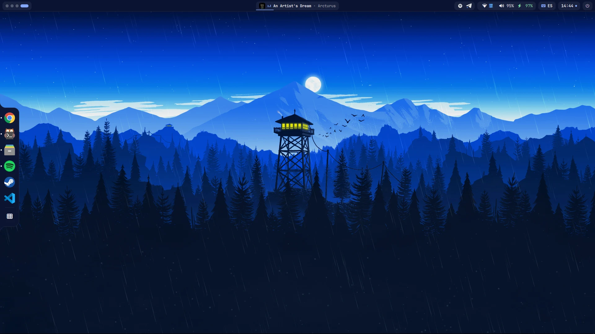
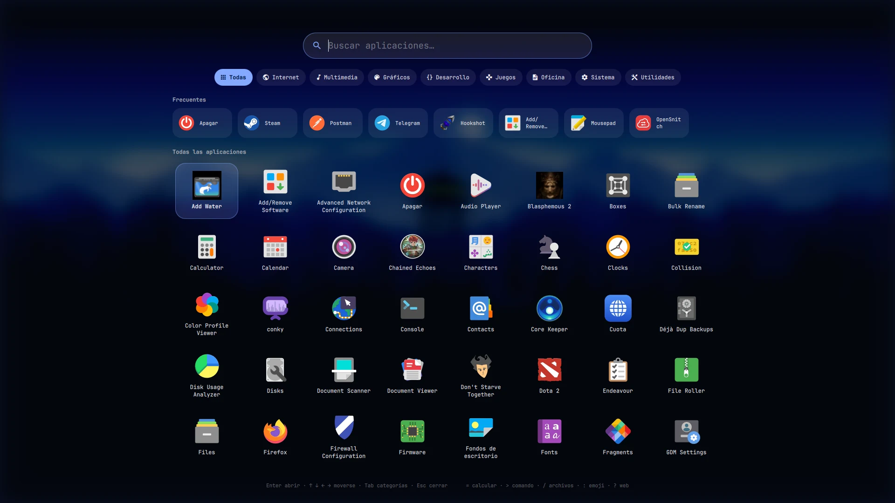
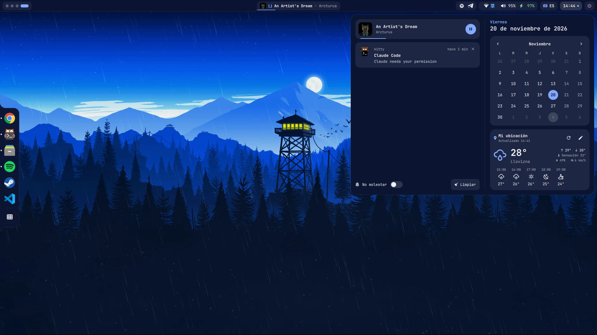
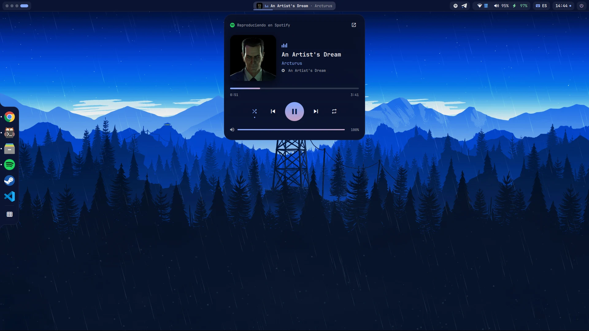
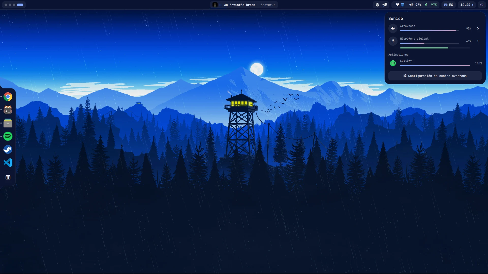
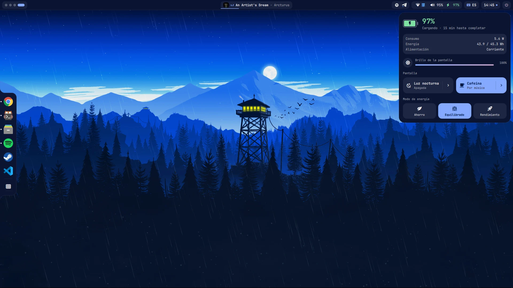
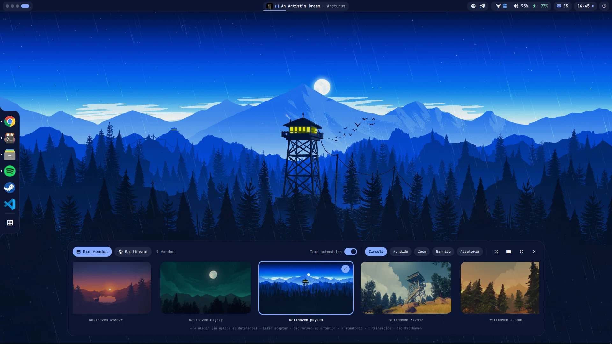
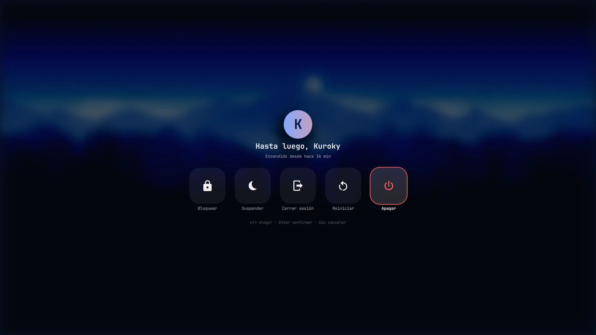
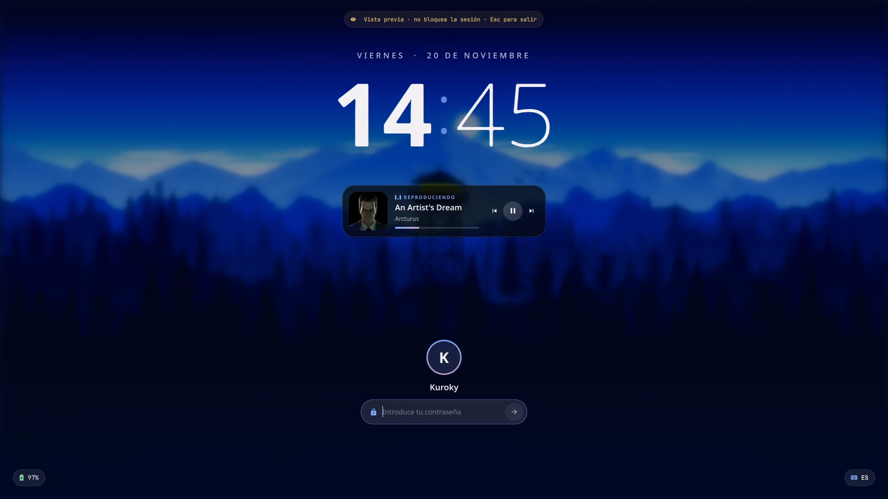

# Escritorio labwc + Quickshell

Mi escritorio Wayland en Manjaro: **labwc** como compositor y **Quickshell** para todo lo demás:
barra, dock, lanzador, notificaciones, OSD, portapapeles, capturas, fondos (con Wallhaven),
panel de audio, red, VPN y proxy, batería, luz nocturna, pantalla de bloqueo y login (greetd).

La idea es que sea bonito sin pedir hardware potente: nada de animaciones continuas, y servicios
bajo demanda en lugar de demonios. Consumo en reposo de la barra: unos 3 % de CPU.



| | |
|---|---|
|  |  |
| **Lanzador** — categorías, frecuentes, calculadora, emoji, archivos y web | **Calendario** — notificaciones, reproductor y clima |
|  |  |
| **Música** — controles MPRIS con carátula | **Sonido** — dispositivos y volumen por aplicación |
|  |  |
| **Energía** — batería, brillo, luz nocturna, cafeína y modo de energía | **Fondos** — propios y de Wallhaven, con transiciones y tema automático |
|  |  |
| **Menú de apagado** | **Pantalla de bloqueo** — el login de greetd usa el mismo diseño |

## Contenido

| Carpeta | Se enlaza en | Qué es |
|---|---|---|
| `quickshell/` | `~/.config/quickshell` | El shell. Estructura y atajos IPC en [`quickshell/README.md`](quickshell/README.md) |
| `quickshell-greeter/` | `~/.config/quickshell-greeter` | Login para greetd con el diseño del lock screen. Ver [`quickshell-greeter/README.md`](quickshell-greeter/README.md) |
| `labwc/` | `~/.config/labwc` | `rc.xml` (atajos), `autostart`, `session.sh`, entorno, menú y tema |
| `systemd/user/cntlm@.service` | `~/.config/systemd/user/` | Un servicio por cada perfil de proxy cntlm |
| `packages.txt` | | Dependencias |
| `install.sh` | | Crea los enlaces simbólicos |

## Instalar en otro equipo

```sh
git clone <url-del-repo> ~/dotfiles
cd ~/dotfiles
sudo pacman -S --needed $(grep -v '^#' packages.txt | grep -v '^aur:' | xargs)
yay -S --needed $(grep '^aur:' packages.txt | cut -d: -f2 | xargs)
sh install.sh
```

`install.sh` no borra nada: si ya hay algo en `~/.config/<x>`, lo renombra a `<x>.pre-dotfiles-<fecha>`.

### GPU (portátil híbrido Intel + NVIDIA)
`labwc/environment` hace que labwc use solo la Intel mediante `WLR_DRM_DEVICES=/dev/dri/igpu`.
Ese nombre lo crea una regla udev que tiene **las direcciones PCI de este portátil**:

```sh
lspci | grep -E 'VGA|3D'      # comprobar que coinciden con labwc/extras/99-gpu-symlinks.rules
sudo cp labwc/extras/99-gpu-symlinks.rules /etc/udev/rules.d/
sudo udevadm control --reload && sudo udevadm trigger --subsystem-match=drm
```

En un equipo con una sola GPU, comenta la línea `WLR_DRM_DEVICES` en `labwc/environment`.
**Si `/dev/dri/igpu` no existe, labwc no arranca.**

### Login (greetd)
Va en dos pasos para no quedarse nunca sin acceso:

```sh
sudo sh ~/.config/quickshell-greeter/install.sh    # modo prueba en Ctrl+Alt+F7; GDM sigue igual
sudo sh ~/.config/quickshell-greeter/activate.sh   # greetd pasa a ser el gestor de inicio
```

Para actualizar el greeter después de editarlo: `sudo sh ~/.config/quickshell-greeter/update.sh`.
Para volver a GDM: `sudo sh ~/.config/quickshell-greeter/revert.sh && sudo reboot` (desde la TTY si hace falta).

## Lo que no está en el repo
- `quickshell/weather.json`: la ubicación del clima. Se crea al elegir una ciudad en el buscador del clima.
- `quickshell/launcher-usage.json`: las apps frecuentes del lanzador.
- Perfiles de cntlm (`~/.config/cntlm/*.conf`): llevan contraseñas.
- Estado en `~/.local/state/quickshell/` (fondo actual, tema, luz nocturna…) e historial del portapapeles.
- Los fondos de `~/Pictures/Wallpapers`.

## Flujo de trabajo
Los archivos de `~/.config` son enlaces a este repo, así que cualquier cambio en el escritorio
aparece directamente en `git status`:

```sh
cd ~/dotfiles && git add -A && git commit -m "barra: …" && git push
```
